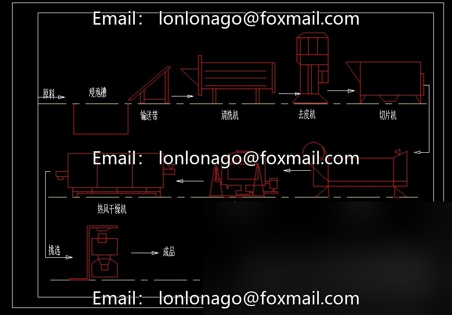
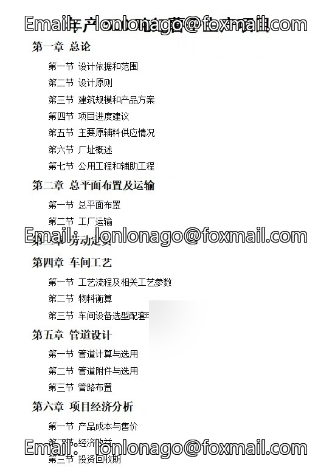
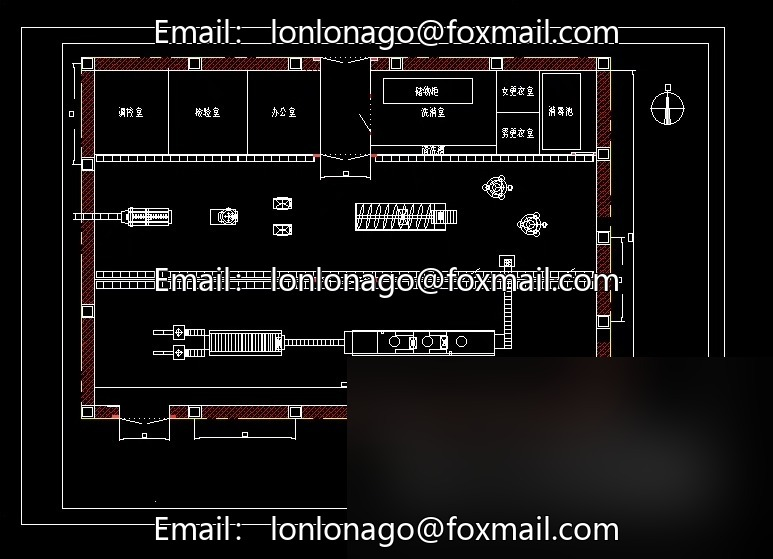
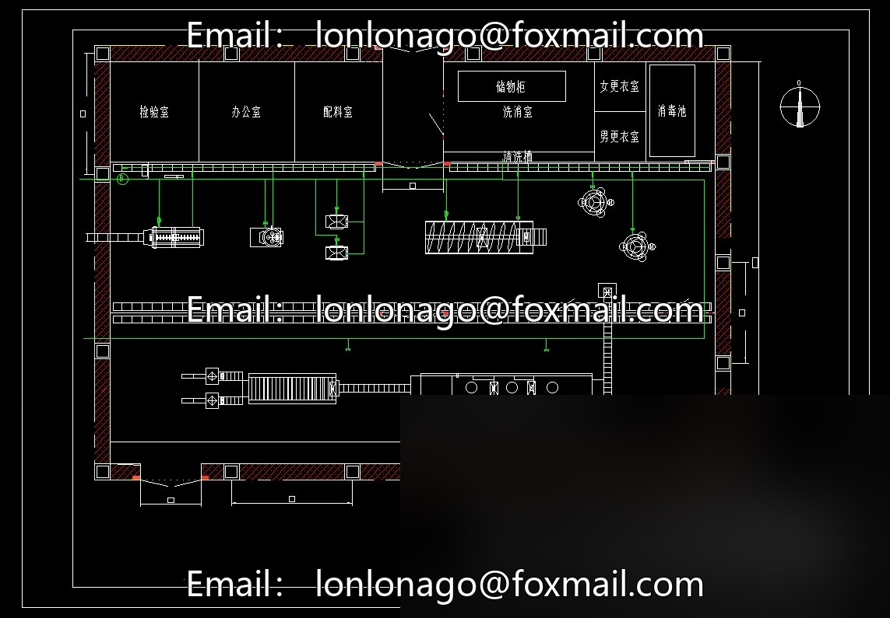

# Potato Sweet Potato Dried Food Factory Design Potato Sweet Potato Processing Design Potato Sweet Potato Food Factory Design Diagram Red

## Body

Rock sorgho food factory design, rock sorgho processing design, rock sorgho food factory design diagram, rock sorgho processing design diagram, rock sorgho food factory design CAD diagram, rock sorgho processing design CAD diagram, 301

Rice potato dried food factory design includes process design diagrams and CAD drawings, along with soaking slots, conveyors, cleaners, peelers, slicers, hot air dryers, a 500-ton annual production project, and chapters such as layout, labor, workshop processes, pipelines and economic analysis, plus storage cabinets and various rooms.

<!-- AI_ENRICHED -->

## Images

## Payment

Here is a pay link on Stripe ( https://buy.stripe.com/3cs8yP7sY87d0vu9AB ). Please contact me lonlonago@foxmail.com after funding $89, and I will send you a complete data files , thank you!

